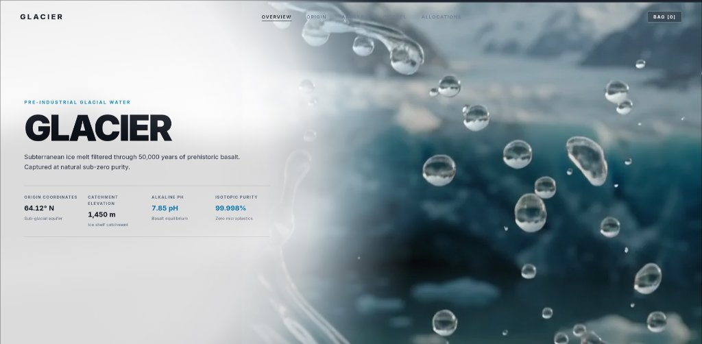
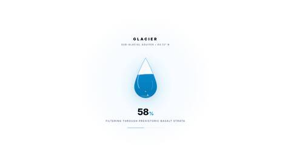
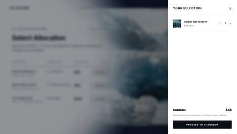

# GLACIER — Natural Mineral Water

<p align="center">
  
</p>

<p align="center">
  <strong>Subterranean Late-Pleistocene Aquifer Captured at Natural Sub-Zero Purity.</strong><br>
  An authentic luxury digital flagship built with React 18, TypeScript, and Vite.
</p>

<p align="center">
  
  
  
  
  
</p>

---

## Table of Contents

- [Overview](#overview)
- [Key Features](#key-features)
  - [1. Liquid Water Drop Preloader](#1-liquid-water-drop-preloader)
  - [2. 192-Frame Canvas Scrubber](#2-192-frame-canvas-scrubber)
  - [3. Calm Monotonic Linear Navigation](#3-calm-monotonic-linear-navigation)
  - [4. Circular Fog Dome Backdrop](#4-circular-fog-dome-backdrop)
  - [5. Open Editorial Matrix](#5-open-editorial-matrix)
  - [6. Cellar Allocations & Shopping Bag Drawer](#6-cellar-allocations--shopping-bag-drawer)
- [Tech Stack](#tech-stack)
- [Project Architecture](#project-architecture)
- [Getting Started](#getting-started)
  - [Prerequisites](#prerequisites)
  - [Installation](#installation)
  - [Development Server](#development-server)
  - [Production Build](#production-build)
- [Controls & Navigation](#controls--navigation)
- [License](#license)

---

## Overview

**GLACIER** is a high-end web experience designed with quiet luxury, anti-AI editorial aesthetics, and architectural precision. It departs from cookie-cutter card grids and generic template patterns, employing:

- Pure editorial typography powered by Google **Inter** with tabular numerals for scientific assays.
- A right-anchored 192-frame cold-press flint bottle animation rendered at device pixel ratio on a 2D canvas.
- Zero physical page scroll (`overflow: hidden !important; 100vh`) with discrete slide docking.
- Bespoke SVG fluid mechanics with rising effervescence and wave oscillations.

---

## Key Features

### 1. Liquid Water Drop Preloader

<p align="center">
  
</p>

- **Sculpted Glass Teardrop**: SVG silhouette with flint glass highlights, specular left-rim curvature, and bottom refraction.
- **Dual Undulating Wave Mechanics**: An SVG `<clipPath>` housing two asynchronous sine waves (`#38bdf8` front wave & `#0284c7` back wave) rising from 0% to 100%.
- **Rising Effervescent Micro-Bubbles**: Dynamic bubbles drifting upwards through the rising water column.
- **Geologic Phase Status**: Evolving phase descriptions tracking actual frame streaming progress (`Extracting Sub-Glacial Melt` → `Basalt Filtration` → `Alkaline Equilibrium` → `Vessel Pressurization` → `Purity Assured`).
- **Bloom & Curtain Reveal**: Smooth ethereal glow pulse at 100% followed by a scale and blur fade transition (`0.85s`) into the active site.

### 2. 192-Frame Canvas Scrubber
- High-performance HTML5 2D canvas dynamically resized to device pixel ratio (`window.devicePixelRatio`).
- Progressive frame streaming: prioritizes key frames first for instant interactivity, then streams remaining frames asynchronously.
- Subpixel linear frame interpolation (`fDelta * 0.14`) anchored at 74% viewport width on desktop.

### 3. Calm Monotonic Linear Navigation
- **Zero Trampoline / Zero Spring Wobble**: Uses pure monotonic exponential smoothing (`pDelta * 0.10`) with `transform: none` on individual slides.
- **Calm Notch Debounce**: 380ms wheel step locking prevents erratic multi-slide skipping.
- **Full Touch & Keyboard Navigation**: Arrow keys (`ArrowUp`/`ArrowDown`), Page keys (`PageUp`/`PageDown`), Space, and touch swipe.
- **Direct Progress Routing**: Supports deep linking via URL query parameters (`?p=0.0` for Hero through `?p=1.00` for Allocations).

### 4. Circular Fog Dome Backdrop
- Centered at `(2vw, 50vh)`, creating a pure white reading field from `0vw` to `32vw`.
- Feathers transparently between `32vw` and `58vw`, leaving the bottle stage completely clear and dark on the right.

### 5. Open Editorial Matrix
- Authentic luxury hairlines (`rgba(9, 14, 23, 0.85)` / `rgba(9, 14, 23, 0.15)`) replacing generic card shadow boxes.
- Clean `/` slashes for section tags (`01 / Geological Source`) with zero em-dashes (`—`).
- Color-coded scientific accents: Cyan (`#0284c7`) for silica/pH, Pure Emerald (`#059669`) for zero nitrates, Gold (`#d97706`) for magnesium.

### 6. Cellar Allocations & Shopping Bag Drawer

<p align="center">
  
</p>

- Direct cellar reservation with live state management (`glacier-still`, `glacier-sparkling`, `glacier-suite`).
- Slide-out luxury bag drawer with frosted glass backdrop (`backdrop-filter: blur(8px)`).
- Quantity modification (`− 1 +`), dynamic subtotal calculation, and concierge checkout dialog.

---

## Tech Stack

| Layer | Technology | Purpose |
|---|---|---|
| **Framework** | React 18.3 | Component architecture & state orchestration |
| **Language** | TypeScript 5.6 | Strict static typing across models, props, and hooks |
| **Bundler** | Vite 6.0 | Ultra-fast HMR and optimized production bundling |
| **Rendering** | HTML5 Canvas 2D | 60 FPS unzoomed frame scrubbing |
| **Vectors** | SVG & CSS3 Keyframes | Fluid water wave physics, bubbles, glass caustics |
| **Typography** | Google Inter | Clean sans-serif with tabular numeric formatting |

---

## Project Architecture

```
Glacier/
├── public/
│   └── assets/                  # Symlinked static assets for Vite
├── src/
│   ├── components/
│   │   ├── BottleCanvas.tsx     # High-DPR 2D bottle canvas renderer
│   │   ├── CartDrawer.tsx       # Shopping bag slide-out drawer
│   │   ├── CircularDome.tsx     # Pure circular fog dome wash
│   │   ├── ContentStage.tsx     # Discrete slide docked container
│   │   ├── Navbar.tsx           # 100% transparent minimalist header
│   │   ├── SlideAllocations.tsx # Slide 4 cellar allocation matrix
│   │   ├── SlideHero.tsx        # Slide 0 hero overview & spec strip
│   │   ├── SlideTable.tsx       # Reusable open matrix table (Slides 1-3)
│   │   └── WaterDropPreloader.tsx # Bespoke liquid drop preloader
│   ├── data/
│   │   └── glacierData.ts       # Centralized specs, tables & products
│   ├── hooks/
│   │   ├── useFramePreloader.ts # Progressive 192-frame asset loader
│   │   └── useScrollNavigation.ts # Monotonic linear lerp scroll hook
│   ├── styles/
│   │   ├── glacier.css          # Core design tokens & typography
│   │   └── preloader.css        # Wave keyframes & preloader styling
│   ├── types/
│   │   └── index.ts             # TypeScript interface contracts
│   ├── App.tsx                  # Root layout coordinator
│   └── main.tsx                 # React DOM mount point
├── assets/
│   └── frames/                  # 192 WebP bottle rotation frames (0001..0192)
├── index.html                   # HTML entry point with Inter font link
├── package.json                 # Project dependencies & scripts
├── tsconfig.json                # Strict TypeScript configuration
└── vite.config.ts               # Vite configuration with React plugin
```

---

## Getting Started

### Prerequisites

- **Node.js**: v18.0.0 or higher (v20+ recommended)
- **Package Manager**: npm (v9+), pnpm, or yarn

### Installation

1. **Clone the repository:**
   ```bash
   git clone https://github.com/your-username/glacier-mineral-water.git
   cd glacier-mineral-water
   ```

2. **Install dependencies:**
   ```bash
   npm install
   ```

3. **Verify esbuild binary initialization (if required by your environment):**
   ```bash
   node ./node_modules/esbuild/install.js
   ```

### Development Server

Start the local Vite development server:
```bash
npm run dev
```

The application will be live at `http://localhost:3000`.

### Production Build

Type-check and create an optimized production bundle:
```bash
npm run build
```

Preview the production build locally:
```bash
npm run preview
```

---

## Controls & Navigation

| Input | Action |
|---|---|
| **Scroll Wheel (Up / Down)** | Step calmly to the previous / next slide (380ms notch debounce) |
| **Arrow Down / Page Down / Space** | Advance to next slide |
| **Arrow Up / Page Up** | Return to previous slide |
| **Touch Swipe (Vertical)** | Mobile gesture step |
| **Navbar Links** | Direct jump to Overview, Origin, Analysis, Vessel, or Allocations |
| **Bag [N] Button** | Open / close shopping bag drawer |
| **Escape Key** | Close open shopping bag drawer |
| **URL Parameters** | Jump directly via query parameter, e.g. `http://localhost:3000/?p=0.50` |

---

## License

This project is licensed under the [MIT License](LICENSE).
